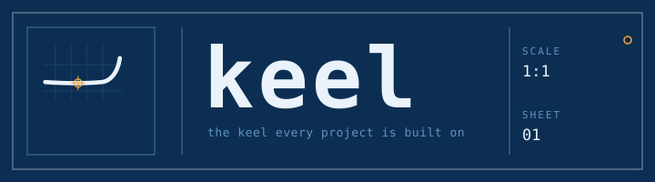

<p align="center">
  
</p>

# keel

> The keel every project is built on - a polyglot golden-path bootstrapper with auth, data, logging, observability, security, and CI baked in.

**keel** scaffolds new projects - single services or full monorepos - with the hard parts already done right: authentication, database and migrations, structured logging, a shared error taxonomy, typed configuration, observability, security controls, docs, and CI/CD.

Every generated project implements the same cross-language **contract** (`platform.yaml`), so a Python service, a TypeScript frontend, and a Rust worker all behave consistently - and `keel update` propagates platform improvements back into projects already created.

The goal: go from zero to a secure, observable, deployable service in minutes, not weeks.

---

## Status

**Active development.** keel is built vertical-by-vertical. Five backend verticals are released - **Python** (v0.1), **Rust** (v0.3), and **Go, Java, and TypeScript/NestJS** (v0.4) - alongside the **frontend monorepo + deployment surface** (v0.2). The **v0.5 generator** is in progress: Copier templates for all five verticals, the `keel` CLI (`new` / `update` / `check`), the `keel update` propagation round-trip, and Tier-3 (a base Helm chart + reusable CI workflows) are done. See the [roadmap](#roadmap) and [docs/STATUS.md](docs/STATUS.md) for implemented-vs-planned detail.

## Why keel

Teams re-derive the same "right way" to start a service over and over - and get it subtly wrong each time. keel encodes the organization's golden path **once**, generates it **consistently** across languages, and keeps existing projects **current** through versioned updates.

- **Runnable + swappable adapters** - real working auth/DB/logging/telemetry behind stable interfaces you can swap (OIDC -> Auth0, Postgres -> MySQL, …).
- **One contract, many languages** - every vertical implements the same `platform.yaml` contract for logging format, error taxonomy, auth, config, and telemetry.
- **Governance baked in** - secret scanning, SBOM, dependency pinning, SAST, security headers, CODEOWNERS, and CI are defaults, not afterthoughts.
- **Updatable** - `keel update` pulls template fixes (including CVE patches) into already-scaffolded projects.

## Roadmap

| Milestone | Scope | Status |
|-----------|-------|--------|
| **v0.1** | Python golden-path vertical (reference contract, runnable) | released |
| **v0.2** | Monorepo + Next.js frontend + deployment surface | released |
| **v0.3** | Rust vertical (contract stress-test) | released |
| **v0.4** | Go, Java & TypeScript/NestJS verticals | released |
| **v0.5** | Copier generator + `keel update` propagation + reusable workflows | in progress |

## Development

keel is a [uv](https://docs.astral.sh/uv/) workspace (ADR-0011). The Python core lives in `packages/keel-core-py`.

```bash
uv sync --all-packages          # create the venv and install all workspace members
uv run pytest                   # tests
uv run ruff check . && uv run ruff format --check .   # lint + format
uv run mypy -p keel_core        # types (strict)
uv run lint-imports             # hexagonal architecture contracts
pre-commit install              # optional: run the fast gates on every commit
```

The full deterministic gate set (ADR-0010) runs in CI on every PR.

## Documentation

- [Architecture](docs/architecture/) - arc42 architecture documentation
- [Architecture Decisions](docs/adr/) - ADRs (MADR format)
- [Contributing](CONTRIBUTING.md) - branching model, PR flow, commit conventions
- [Security](SECURITY.md) - reporting vulnerabilities

## License

[Apache-2.0](LICENSE) © 2026 Jeet Parekh

The keel name and the logo and brand assets in [`assets/brand/`](assets/brand/) are not
covered by the Apache-2.0 license. They are copyright Jeet Parekh, all rights reserved,
and may not be used to represent a derived or unaffiliated project. See
[`assets/brand/README.md`](assets/brand/README.md).
